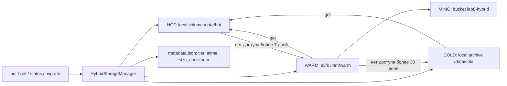

# Гибридное хранилище TechData Solutions

## Executive Summary

Для медиакомпании TechData Solutions предлагается хранить активные проекты на SSD/NVMe,
недавние — в S3-совместимом MinIO через s3fs, архивы — на дешёвом архивном уровне.
Менеджер автоматически понижает уровень по времени доступа и возвращает запрошенный
файл в HOT. Локальный PoC проверяет механизм на небольших файлах.
Он не воспроизводит объём 500 TB, отказоустойчивость и производственные SLA.

## Бизнес-требования

Объём — 500+ TB видеоконтента. Для расчёта ниже взята нижняя граница 500 TB.

| Уровень | Доля и объём при 500 TB | Цель доступа | Назначение |
|---|---|---|---|
| HOT | 10%, 50 TB | < 10 мс, 24/7 | Активные проекты |
| WARM | 30%, 150 TB | < 100 мс, ежедневный доступ | Недавние проекты |
| COLD | 60%, 300 TB | Восстановление в течение часов | Архивы |

Бизнес-цель — снизить стоимость хранения с сохранением доступа к активным проектам.
Числа latency являются целями проектирования, а не измеренными характеристиками PoC.
Доли 10/30/60 — допущение о составе данных; возрастная политика сама по себе их не гарантирует.

## Архитектура решения

Два контейнера: MinIO и tools с s3fs и Python. WARM является реальным FUSE mount
в пространстве монтирования того же контейнера, что и менеджер.
Отдельный s3fs-контейнер и попытка передавать mount через именованный volume исключены.
Один MinIO обслуживает также отдельный bucket бенчмарка; ключи данных не пересекаются.
На хост опубликованы только loopback-порты 9000/9001; credentials явно учебные.

HOT, COLD и metadata.json находятся в постоянном volume hybrid-data, данные MinIO —
в minio-data. COLD имитируется отдельной папкой; это не AWS Glacier, не платная услуга
и не физически независимый архив. Задержка восстановления в часы искусственно не добавляется.
В реальной системе COLD и резервные копии должны находиться на независимых носителях.

## Политики миграции и целостность

`put` создаёт новый файл в HOT. `get` из WARM/COLD сначала копирует его в HOT,
проверяет SHA-256, затем обновляет время доступа. `status` и `migrate` не считаются
пользовательским чтением и не обновляют atime. Повторное имя в put отклоняется,
чтобы минимума PoC не усложнять версиями и конкурентной перезаписью.

HOT → WARM при `now - last_accessed > 7 * 86400`.
WARM → COLD при `now - last_accessed > 30 * 86400`.
Оба порога относятся к последнему пользовательскому доступу, а не ко времени миграции.
За один проход выполняется один переход на файл; давно не читавшийся HOT-файл
пройдёт через WARM и уйдёт в COLD на следующей проверке.
Проверка запускается каждые 60 секунд фоновым потоком работающего приложения;
команда migrate выполняет её немедленно. В остановленном приложении миграция не идёт.

Перенос: проверить checksum исходника → скопировать во временный файл назначения →
проверить размер и SHA-256 копии → переименовать копию → атомарно заменить JSON →
удалить исходник. Ошибка копирования/проверки/записи JSON оставляет исходник.
После прерывания между сохранением JSON и удалением исходника возможна лишняя копия;
авторитетное расположение указано в JSON. Такая копия предпочтительнее потери данных.
Это защита порядка переноса на уровне приложения, а не гарантия от отказа всего диска
или внезапной потери питания. Независимые backups и проверка восстановления нужны в production.
RLock защищает фоновый поток и команды одного процесса; несколько менеджеров
с одним JSON одновременно запускать нельзя.

Тесты искусственно старят metadata только внутри своих временных каталогов.
Интеграционная команда и сценарий put/get/status/migrate приведены в README.
Фактическая проверка на 17.10.2026: все 7 тестов менеджера прошли с реальным s3fs WARM,
включая HOT → WARM → COLD и оба варианта возврата в HOT. Отдельно файл в WARM
и JSON пережили stop/up MinIO и tools; после запуска get восстановил байты в HOT.

## Экономический анализ TCO

Все цены ниже — **условные учебные единицы**, не рыночные тарифы и не коммерческое
предложение. Горизонт — 12 месяцев, постоянный объём V = 500 TB без роста.
Предположим приведённую стоимость TB/месяц: H = 100, W = 20, C = 5 единиц;
она уже включает амортизацию носителей, поэтому отдельный CAPEX повторно не прибавляется.
Дополнительные ежемесячные расходы гибридного решения: O = 1000 на сопровождение,
R = 500 на миграции/извлечение. Для all-HOT дополнительные расходы приняты равными нулю.
Это упрощённые допущения для сравнения двух вариантов, их нужно заменить фактическими сметами.

`TCO_hot(T, V) = T * V * H`

`TCO_hybrid(T, V) = T * (0.10*V*H + 0.30*V*W + 0.60*V*C + O + R)`

При заданных допущениях: all-HOT = `12 * 500 * 100 = 600000` единиц;
hybrid = `12 * (50*100 + 150*20 + 300*5 + 1000 + 500) = 132000` единиц.
Условная экономия = 468000 единиц, или 78%. Это результат формулы с допущениями,
а не измеренная экономия TechData Solutions. Преимущество исчезает, если дополнительные
ежемесячные расходы превысят `V*H - (0.1*V*H + 0.3*V*W + 0.6*V*C)` = 40500 единиц.
Рост объёма, репликация, сеть, восстановление и персонал могут изменить сравнение;
их необходимо учесть до закупки.

## План внедрения

1. Инвентаризировать данные, реальные обращения и требования восстановления; измерить all-HOT baseline.
2. Проверить PoC на тестовом наборе: переносы, ошибки копирования, перезапуск и возврат архива.
3. Провести пилот на копии выбранных проектов; измерить latency и длительность восстановления,
   проверить backups и независимость архивного носителя.
4. Переносить данные поэтапно после проверки целостности; сравнивать фактическую стоимость
   с формулой, корректировать пороги по SLA и результатам пилота.

## Мониторинг

В PoC достаточно `status`, сообщений `automatic migrate`/`automatic migrate error`,
`docker compose ps`, `docker compose logs` и FUSE-логов `/tmp/warm.log`.
Контролировать число/объём файлов по tier, возраст доступа, ошибки миграций и свободное место
в HOT/COLD/MinIO. Checksum проверяется при чтении и переносах. Мониторинговый стек не нужен.
Перед production необходимы измерения p95/p99 доступа, времени восстановления и регулярная
проверка резервных копий; эта лабораторная не подтверждает доступность 24/7.
