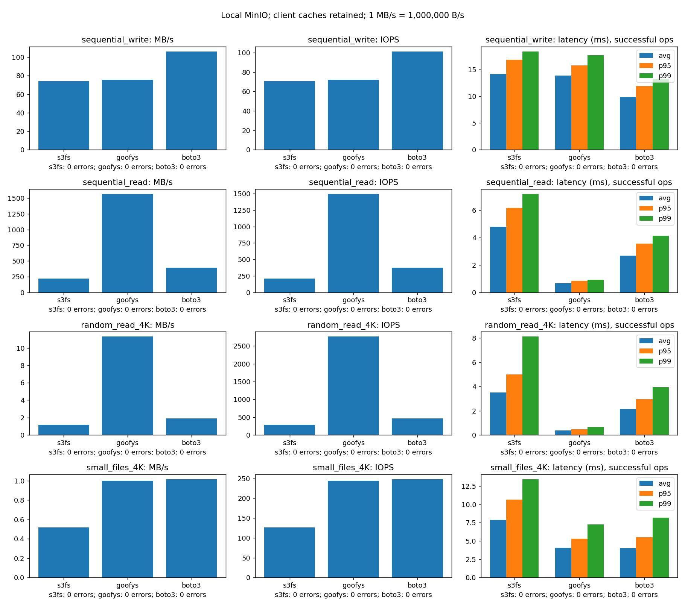

# Сравнение способов доступа к S3

## Введение

Цель — сравнить s3fs, goofys и нативный boto3 на одном локальном MinIO.
FUSE переводит файловые вызовы в обращения к S3; boto3 работает с объектами напрямую.
Исследуются последовательные запись/чтение, случайное чтение блоков и создание маленьких файлов.

## Методология и стенд

Windows, Docker Desktop Linux engine на WSL2; MinIO и клиент находятся в одной Docker-сети.
Один процесс клиента последовательно выполняет методы s3fs, goofys, boto3;
запуски не выполняются одновременно. Версия исходников MinIO —
`RELEASE.2025-09-07T16-13-09Z`, goofys — 0.24.0; версии Python-пакетов зафиксированы
в requirements.txt, s3fs устанавливается из Debian bookworm.
Точные Python/OS/версии пакетов и параметры каждого прогона сохраняются в JSON.
Фактический стенд 17.10.2026: Docker Engine 29.8.2, Compose 5.6.0,
WSL kernel 6.18.54.1; Docker видит 22 CPU и 16464146432 B RAM.
Клиент: Python 3.12.12, s3fs 1.90, goofys 0.24.0, boto3 1.40.52,
matplotlib 3.10.7. Собранный MinIO сообщает DEVELOPMENT.GOGET: это его
стандартная метка при go install, исходный релиз зафиксирован в Dockerfile.

| Нагрузка | Операций на метод по умолчанию | Объём на метод |
|---|---:|---:|
| Sequential write | 100 × 1 MiB | 104857600 B |
| Sequential read | 100 × 1 MiB | 104857600 B |
| Random read | 1000 × 4096 B | 4096000 B |
| Small files write | 1000 × 4096 B | 4096000 B |

1 MiB = 1048576 B; throughput выводится в десятичных MB/s, 1 MB = 1000000 B.
Payload одинаков для всех методов; начальный набор создаётся sequential write.
Random seed = 8, одинаковые индексы объектов и смещения, блок 4096 B.
Для FUSE измеряется open/seek/read/close, для S3 — GET с Range и закрытием Body.
Это сопоставимые задачи чтения диапазона, но разные сетевые и POSIX операции.
Маленькие файлы создаются с уникальными именами; существующие данные не перезаписываются.

Каждая операция измеряется `time.perf_counter()`. Время записи включает close
для FUSE и завершение PUT для boto3. У goofys fsync не является гарантией upload,
поэтому одинаковая fsync-долговечность не заявляется. Проверка считанных байтов
входит в latency. Подготовка payload/каталогов и генерация графиков исключены.

Throughput = успешные байты / всё время нагрузки / 1000000.
IOPS = успешные операции / всё время нагрузки. Ошибки входят в общее время,
но не в успешные байты и IOPS. Avg/p95/p99 рассчитываются по успешным операциям;
перцентили — nearest rank, `ceil(p*N)`. При отсутствии успешных операций latency = null.
JSON содержит каждую попытку, её latency, байты и текст ошибки.

Кэши ОС, FUSE и S3-клиентов не очищаются; чтение следует сразу за записью.
Disk cache s3fs (`use_cache`) и catfs для goofys специально не включены, но их
внутренние и page caches остаются. Это измерение работы клиента с сохранёнными кэшами,
а не скорости дисков или «холодного» S3. Порядок методов может влиять на результат.
Прогон с малым числом операций проверяет работоспособность, а не устойчивую производительность.

## Результаты

Полный прогон действительно выполнен 17.10.2026 в 12:49 по Москве
(начало JSON: 09:49 UTC). Все 6600 операций успешны: по 2200 на метод,
12 серий, 0 ошибок. Результаты ниже округлены, исходные значения и все попытки
сохранены в `results/benchmark.json`.

| Метод | Нагрузка | MB/s | IOPS | avg мс | p95 мс | p99 мс |
|---|---|---:|---:|---:|---:|---:|
| s3fs | Sequential write | 74.217 | 70.78 | 14.122 | 16.767 | 18.359 |
| goofys | Sequential write | 75.608 | 72.11 | 13.863 | 15.756 | 17.641 |
| boto3 | Sequential write | 106.246 | 101.32 | 9.868 | 11.870 | 13.218 |
| s3fs | Sequential read | 218.881 | 208.74 | 4.787 | 6.159 | 7.174 |
| goofys | Sequential read | 1566.473 | 1493.91 | 0.667 | 0.825 | 0.932 |
| boto3 | Sequential read | 391.257 | 373.13 | 2.678 | 3.545 | 4.120 |
| s3fs | Random read 4K | 1.172 | 286.02 | 3.494 | 5.001 | 8.124 |
| goofys | Random read 4K | 11.319 | 2763.44 | 0.361 | 0.470 | 0.639 |
| boto3 | Random read 4K | 1.912 | 466.69 | 2.142 | 2.960 | 3.935 |
| s3fs | Small files 4K | 0.518 | 126.54 | 7.900 | 10.637 | 13.443 |
| goofys | Small files 4K | 1.000 | 244.21 | 4.092 | 5.291 | 7.254 |
| boto3 | Small files 4K | 1.016 | 247.99 | 4.031 | 5.489 | 8.162 |



Команда повторного полного измерения:

```powershell
docker compose exec -T tools python benchmark.py --output /results/benchmark.json
```

Она создаёт сырые данные `results/benchmark.json` и график `results/benchmark.png`:
отдельная строка на нагрузку, столбцы throughput/IOPS/avg-p95-p99, число ошибок подписано.
График перестраивается без нового измерения:

```powershell
docker compose exec -T tools python benchmark.py --plot /results/benchmark.json
```

## Анализ

В этом прогоне boto3 показал наибольшую скорость последовательной записи — 106.246 MB/s.
goofys показал наибольшую скорость чтения после записи: 1566.473 MB/s и 2763.44 IOPS
для блоков 4K. Интерпретация: сохранённые клиентские/page caches и различия путей
чтения могли существенно повлиять на результат; сам тест не отделяет их вклад.
У S3 Range GET каждый вызов обращается к API, поэтому высокая скорость чтения
goofys не доказывает превосходство S3-сервера или диска при таком доступе.

Создание маленьких файлов через goofys и boto3 дало близкие 244.21 и 247.99 IOPS;
разницы одного прогона недостаточно для устойчивого ранжирования этих двух методов.
s3fs в этой нагрузке показал 126.54 IOPS и p99 13.443 мс. Возможные причины —
расходы на файловые метаданные и запросы, однако трассировка запросов не выполнялась,
поэтому это объяснение остаётся предположением.

Повторные прогоны с новыми UUID и одинаковыми параметрами нужны для оценки разброса.
«Холодный» кэш, случайная запись, многопользовательская нагрузка и отдельные машины
не измерялись. Время Range GET нельзя называть latency физического случайного чтения диска.
Этот PoC не подтверждает SLA архитектуры на 500 TB.

## Рекомендации

s3fs подходит для демонстрации интеграции существующего файлового приложения с S3.
goofys следует рассматривать для преимущественно последовательного файлового доступа,
когда допустимы ограничения POSIX; случайная запись здесь не измеряется.
boto3 подходит коду, который может явно работать с объектами и диапазонами S3.
Выбор по производительности следует делать только после реальных результатов
для нужной нагрузки и проверки требуемой семантики записи.

Семантика goofys (включая flush при close): [официальное описание](https://github.com/kahing/goofys).
Параметры s3fs: [официальная man page](https://github.com/s3fs-fuse/s3fs-fuse/blob/master/doc/man/s3fs.1.in).
